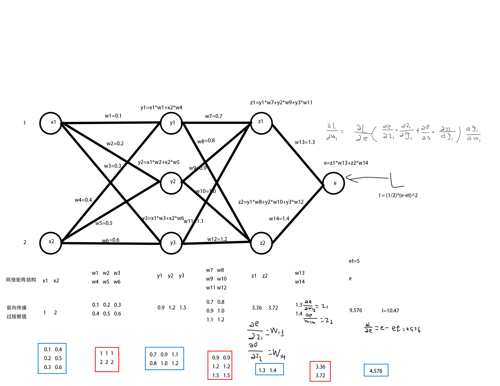

# neural-network-C

基于 C 语言实现的神经网络学习工程，支持全连接层、标准多通道卷积、最大池化、展平、ReLU / sigmoid、前向推理、反向传播和 SGD。张量使用连续内存，形状为 `(dim, h, w)`。

## 文件结构

| 文件 | 作用 |
|---|---|
| `src/tensor.c`、`src/tensor.h` | 张量创建、释放、矩阵与逐元素运算、梯度存储 |
| `src/compute.c`、`src/compute.h` | 激活函数、MSE 损失及其导数 |
| `src/net.c`、`src/net.h` | 网络与层管理、前后向传播、参数更新和网络释放 |
| `src/main.c` | MNIST 数据读取、mini-batch 训练和测试集评估 |
| `MNIST.7z` | MNIST 数据压缩包 |

## 编译与运行

需要支持 C99 或更新标准的 C 编译器。以下命令在仓库根目录运行：

```sh
gcc -std=c11 -O2 -Wall -o neural-network.exe src/main.c src/net.c src/tensor.c src/compute.c -lm
```

将 `MNIST.7z` 中的四个 IDX 原始数据文件解压到程序运行时的工作目录：

```text
train-images-idx3-ubyte
train-labels-idx1-ubyte
t10k-images-idx3-ubyte
t10k-labels-idx1-ubyte
```

然后运行程序。在 Windows PowerShell 中：

```powershell
.\neural-network.exe
```

使用小熊猫 C++ 时，将 `src` 中的四个 `.c` 文件及对应头文件加入同一个 C 工程，工作目录设为上述数据文件所在目录，再执行编译运行。仓库本身不包含 `.dev` 工程文件。

## MNIST 示例网络

```text
输入 (1,28,28)
→ Conv2D(1→64, 3×3, stride=1, padding=1) + ReLU
→ MaxPool(2)
→ Conv2D(64→32, 3×3, stride=1, padding=1) + ReLU
→ MaxPool(2)
→ Flatten：1568
→ FC(1568→512) + ReLU
→ FC(512→64) + ReLU
→ FC(64→10)，无激活
```

像素除以 255，标签转为 one-hot。损失使用 `0.5 * sum((output-target)^2)`，分类结果取最大输出的下标。

`main.c` 中的默认参数：

| 参数 | 默认值 |
|---|---:|
| `EPOCHS` | 2 |
| `LR` | 0.01 |
| `BATCH_SIZE` | 32 |
| `TRAIN_PRINT_EVERY` | 100 |

每个样本执行前向和反向，梯度在参数中累加；每满一批，以平均梯度更新一次。最后不足一批时按实际样本数更新。随机种子由主程序统一设置为 `12345`。

每轮打印的训练准确率是从该轮开头累计的在线指标，统计期间参数会不断变化，不是对最终模型重新评估训练集的结果，也不保证每次打印都上升。batch size 为 32 时，前 300 个样本只有 9 次更新；与逐样本 SGD 比较收敛速度时，需要同时考虑更新次数、学习率和训练轮数。

## 接口使用

```c
srand(12345); /* 在创建随机参数之前统一设置种子 */
net_handle model = create_net();
add_fc_layer(model, 2, 4, relu);
add_fc_layer(model, 4, 2, none);

float sample[1][2] = {{0.2f, 0.8f}};
float target[1][2] = {{0.0f, 1.0f}};
tensor_handle x = create_tensor_from_twodim_arr(1, 2, nograd, sample);
tensor_handle y = create_tensor_from_twodim_arr(1, 2, nograd, target);

net_zero_grad(model);
forward(model, x);
float loss = compute_lose(model, MSE, y);
backward(model, MSE_d, y);
optimizer(model, 0.01f);

remove_net(model); /* 释放网络拥有的参数、层和缓存 */
remove_tensor(x);  /* 输入和目标由调用者释放 */
remove_tensor(y);
```

自定义 mini-batch 循环时，每批开始清零梯度，逐样本反向累加，最后调用 `optimizer(model, learning_rate / actual_batch_count)`，再清零梯度。只在批边界更新参数，不要在批内每个样本反向前清零。

`add_fc_layer_with_params` 会复制传入的权重和偏置数组。`forward` 的层输出缓存会在下一次前向时释放，若需要保留预测值，请先复制数据。错误的输入形状可能使前向停止，调用者应检查有效输出后再使用结果。

## 全连接层数学推导



## 当前限制

- 每批通过逐样本累加梯度实现，尚未实现批量张量并行计算。
- 示例仍按原始顺序读取训练样本，没有样本洗牌。
- 参数保存和加载尚未实现。
- 内存分配失败及所有张量尺寸溢出路径尚未全面处理。
